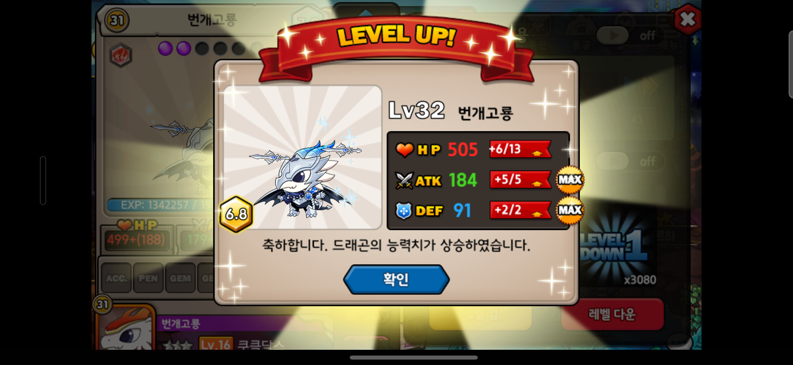

# Dragon Village Loop

드래곤빌리지 드래곤을 **7.0 등급을 유지한 채 만렙까지** 올려주는 안드로이드 앱입니다.
능력치가 전부 최대로 뜰 때까지 데삭을 반복하는 작업을 대신합니다.

> 위 화면에서 HP 가 `+6/13` 이라 MAX 가 아닙니다. 등급이 7.0 → 6.8 로 떨어졌으니 데삭 대상입니다.
> 앱은 이 판단을 화면 픽셀로 직접 합니다.

## 기능

**자동 레벨업 반복** — 레벨업 아이템을 하나씩 사용하고 결과를 판정합니다. 여러 개를 한 번에 쓰지 않습니다.

**트리플 맥스 판정** — HP·ATK·DEF 세 능력치의 MAX 뱃지를 화면에서 읽어 성공 여부를 가립니다.

**실패 시 자동 복구** — 데이터 삭제 → 재로그인 → 원래 자리 복귀까지 스스로 처리합니다.

**안전장치** — 계정 삭제 버튼은 좌표 차단과 화면 검증으로 이중으로 막습니다. 예상 밖 화면이 나오면 아무것도 누르지 않고 멈춥니다.

## 시작하기

> **안드로이드 전용입니다.** 아이폰은 앱 데이터만 골라 지울 수 없어 데삭이 불가능합니다.

### 설치

[Releases](../../releases) 에서 APK 를 받아 휴대폰에서 실행합니다.
"이 출처의 앱은 설치할 수 없습니다" 가 뜨면 안내에 따라 **이 출처 허용** 을 켭니다.

### 권한

앱을 처음 열면 두 가지를 요청합니다.

| 권한 | 용도 |
| --- | --- |
| 접근성 | 게임 화면을 대신 누르기 |
| 화면 녹화 | 결과 화면을 읽어 판정하기 |

화면은 판정에만 쓰이며 밖으로 나가지 않습니다.

### 데이터 삭제 방식

둘 중 하나를 고릅니다. 처음이라면 **간편 방법** 으로 시작하세요.

- **간편** — 앱이 `설정 → 애플리케이션 → 드래곤빌리지 → 저장공간 → 데이터 삭제` 를 대신 눌러줍니다. 추가 설치가 없습니다.
- **빠름** — [Shizuku](https://shizuku.rikka.app/) 를 쓰면 즉시 처리됩니다. 재부팅할 때마다 Shizuku 를 한 번 실행해야 합니다.

### 실행

1. 게임을 켜서 **월드 지도** 까지 들어갑니다
2. 앱에서 **시작** 을 누릅니다

멈추고 싶으면 언제든 정지를 누르세요. 마지막 저장 상태는 그대로 남습니다.

## 설정

**설정** 탭에서 바꾸며, 실행 중 변경해도 다음 시도부터 반영됩니다.

| 항목 | 설명 |
| --- | --- |
| 대상 드래곤 | 목록에서 그림을 보고 고릅니다 |
| 사용 아이템 | 각성 드래곤은 각성 전용 아이템만 쓸 수 있습니다 |
| 목표 레벨 | 여기까지 올리면 멈춥니다 |
| 최대 시도 횟수 | 안전장치. 넘으면 멈춥니다 |
| 계정 | 하이브로 아이디. 비밀번호는 휴대폰 보안 저장소에 저장됩니다 |
| 대기 시간 | 기기가 느려 화면 전환을 놓치면 늘립니다 |

설정 파일 형식은 [스키마 문서](docs/SCHEMA.md) 를 참고하세요.

## 업데이트

새 APK 를 받아 그대로 설치하면 덮어씌워집니다. **설정과 진행 기록은 유지됩니다.**
**정보 → 업데이트 확인** 에서 새 버전을 확인할 수 있으며, 자동으로 설치하지는 않습니다.

## 성능

번개고룡 · 각성 Lv+1 아이템 기준 실측값입니다.

| 항목 | 값 |
| --- | --- |
| 한 번 시도 | 실패 78초 · 성공 44초 |
| MAX 확률 | HP 17% · ATK 66% · DEF 83% |
| 세 개 모두 MAX | **3.4%** |
| 한 레벨 올리기 | 평균 30회 시도 · 약 40분 |

HP 는 상승 폭이 가장 커서 최대값이 나올 확률이 제일 낮고, 사실상 전체 속도를 결정합니다.
몇 시간 동안 돌아가니 **충전기에 꽂고 화면이 꺼지지 않게** 해주세요.

## 개발 현황

| | |
| --- | --- |
| 루프 엔진 (Python · PC + USB) | ✅ 동작 확인 |
| 안드로이드 앱 (Kotlin) | 🚧 개발 중 |
| 드래곤 목록 자동 인식 | 🚧 개발 중 |

## 문서

- [브랜치 전략](docs/BRANCH_STRATEGY.md) — 이슈 기반 작업, `dev` → `release` → `main`
- [커밋 컨벤션](docs/COMMIT_CONVENTION.md) — 한국어 + gitmoji + 3 섹션
- [데이터 스키마](docs/SCHEMA.md) — 설정 · 상태 · 이벤트 형식
- [운영 규칙](CLAUDE.md) — 좌표, 판정 기준, 사고 기록

## 기여

모든 작업은 [이슈](../../issues) 에서 시작해 PR 로 끝납니다.
문제를 발견하셨다면 멈춘 화면 사진, 기기 이름과 안드로이드 버전, 게임 버전을 함께 남겨주세요.

## 주의

이 앱은 **화면을 보고 화면을 누르는 일** 만 합니다. 게임 파일이나 통신 내용을 고치지 않고,
서버에 직접 요청을 보내지 않으며, 결제 화면에는 들어가지 않습니다.

다만 자동 반복은 대부분의 모바일 게임 약관에서 금지하고 있습니다.
**계정 정지 위험이 있으며 그 판단과 책임은 사용하는 분에게 있습니다.**

## 라이선스

[MIT](LICENSE)
